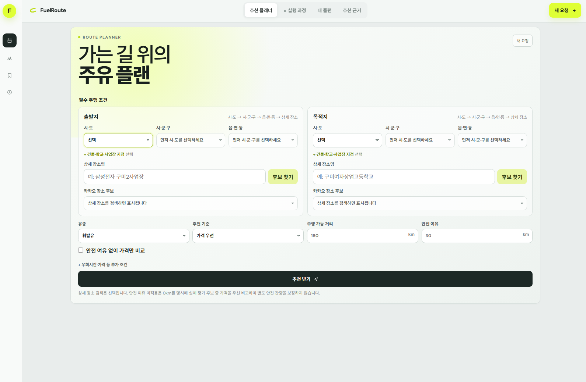
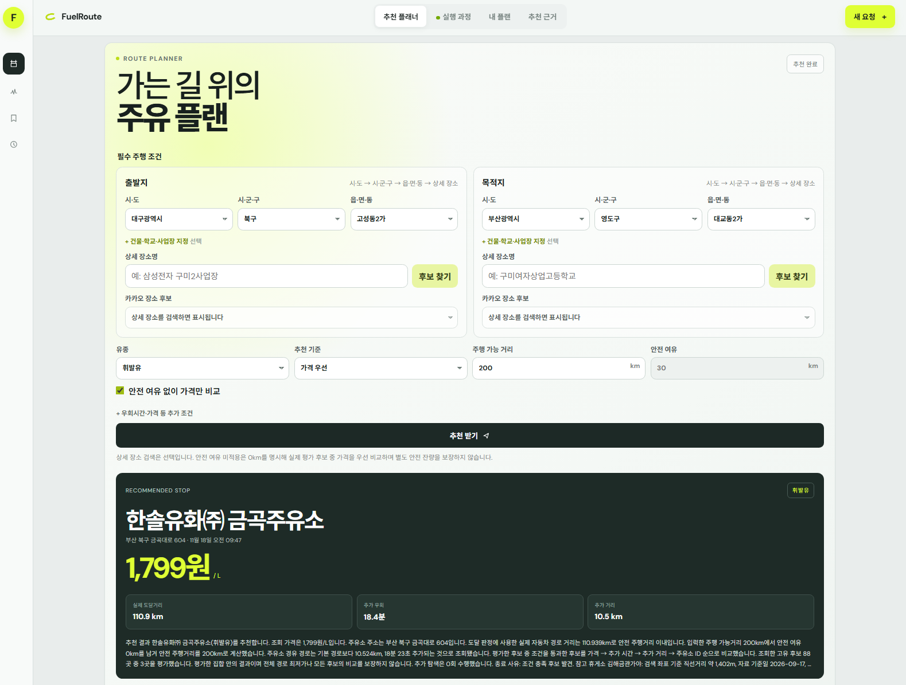
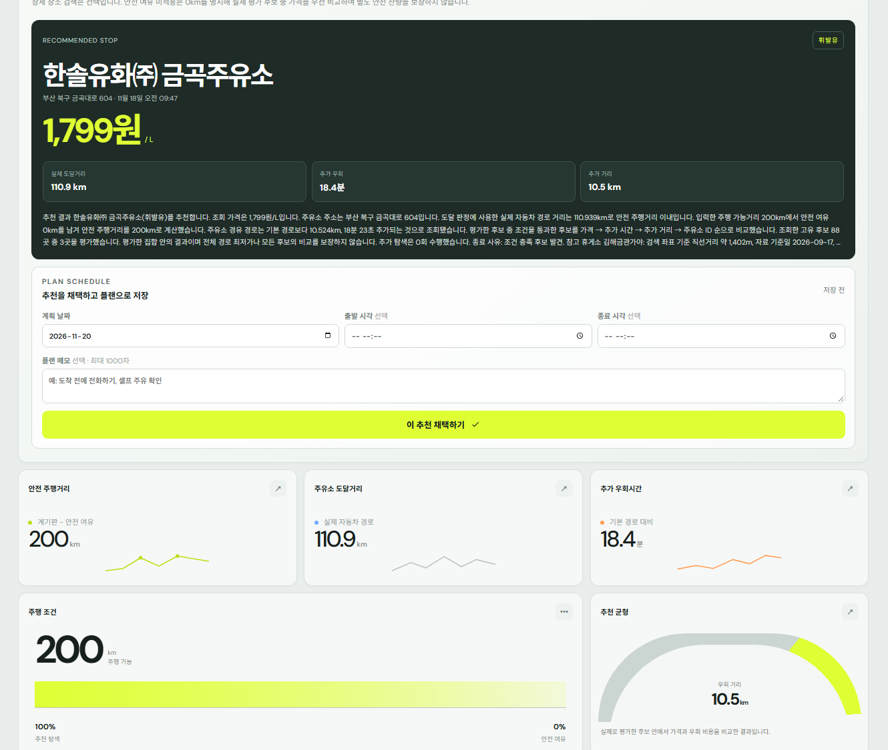
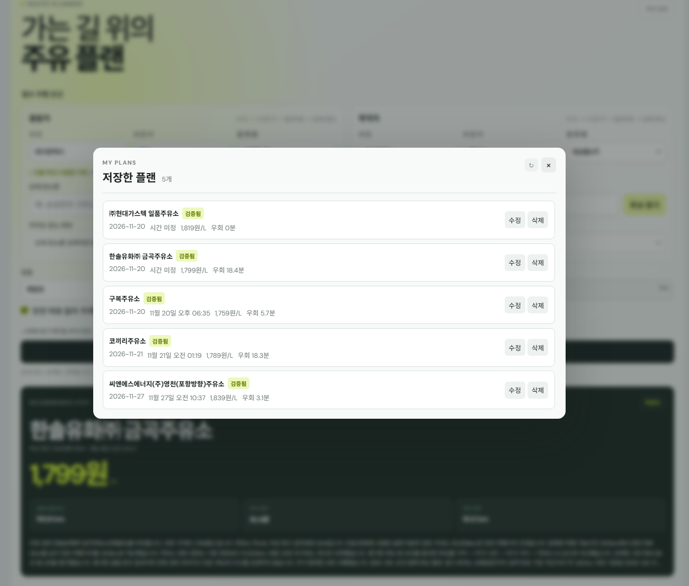
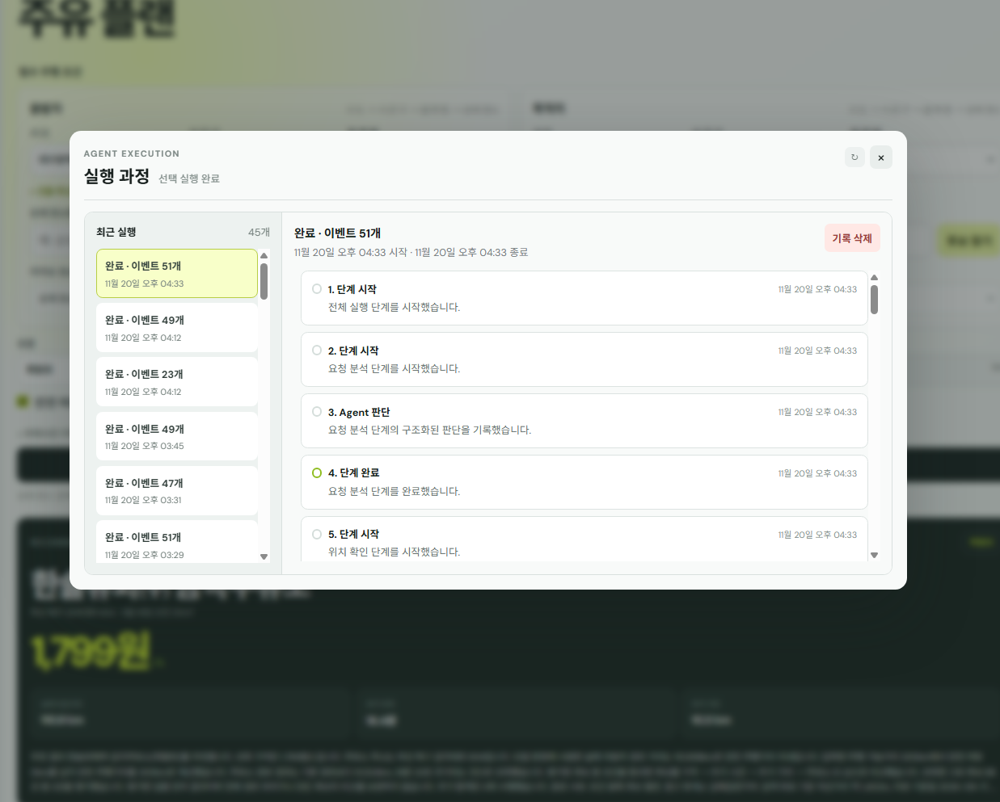
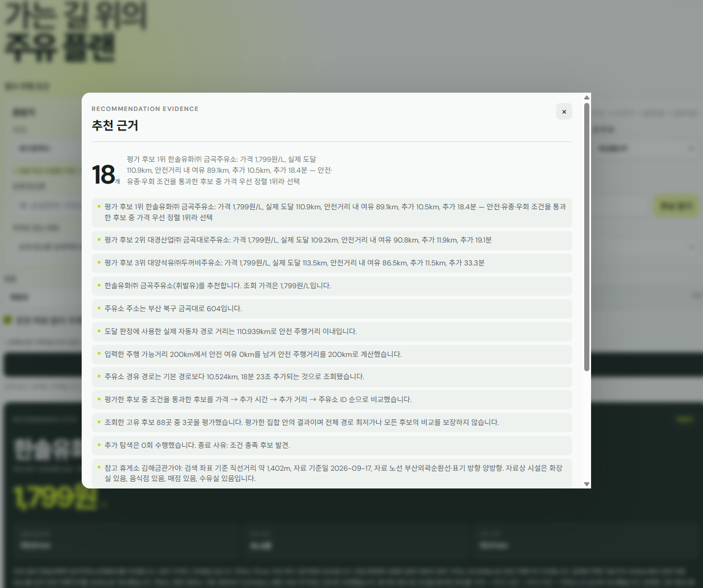

# FuelRoute Agent

## 서비스 한 줄 소개

**계기판의 주행 가능 거리(km)에서 안전 여유(km)를 빼 안전하게 도달 가능한 구간을 계산하고, 목적지까지의 경로상에서 접근 가능한 주유소의 가격과 우회 비용을 비교해 합리적인 주유 지점을 추천하는 Agent 기반 플래너.**

## 프로젝트 배경

장거리 운전 중에는 “가장 싼 주유소”가 반드시 가장 좋은 선택은 아니다.

운전자는 동시에 다음을 판단해야 한다.

- 현재 남은 연료로 해당 주유소까지 갈 수 있는가?
- 안전하게 남겨야 할 연료를 침범하지 않는가?
- 목적지 경로에서 얼마나 벗어나는가?
- 더 싼 주유소를 방문하기 위해 추가로 소모하는 시간과 연료가 합리적인가?
- 현재 조건으로 추천 가능한 후보가 없다면 다른 후보를 다시 찾아야 하는가?

FuelRoute는 단순 주변 최저가 검색이 아니라 **도달 가능성 → 사용자 제약 → 우회 비용 → 가격**을 함께 판단하는 것을 목표로 한다.

## 핵심 기능 요약

- 출발지·목적지·유종·주행 가능 거리(km)·남길 안전 여유(km) 입력
- 목적지까지 자동차 경로 조회
- 현재 조건에서의 안전 주행 가능 거리 계산
- 안전하게 도달 가능한 경로 구간에서 주유소 후보 탐색
- 후보별 가격 및 상세정보 조회
- 후보 주유소 경유 시 실제 추가 거리·시간 계산
- 조건을 만족하지 않는 후보 제외
- 조건을 만족하는 후보가 없을 경우 재계획
- 추천 근거와 제외 사유 제공
- 생성한 주유 계획 저장·조회·수정·삭제
- Agent 실행 과정 및 Tool 호출 이력 기록

상세 기획은 [`docs/PRD.md`](docs/PRD.md)를 참고한다.

## 기술 스택

### 원본 프로젝트 명세에서 요구되거나 허용된 기술

| 영역 | 기술 | 상태 |
|---|---|---|
| Language | Python 3.11+ | 3.11.9 검증; pyproj 3.7.2 요구 버전 반영 |
| Agent | LangGraph | 확정 |
| LLM Integration | GMS + LangChain `ChatOpenAI` | 현재 계정의 텍스트·구조화 출력·Tool 왕복 실호출 검증 완료 |
| Backend | FastAPI | 확정 |
| Database | SQLite | 확정 |
| Frontend | HTML/CSS/JavaScript 또는 Vue.js | **미정** |
| External Data | 외부 API 3종 이상 | 필수 조건 |

### 사용할 API

| API | 용도 | 상태 |
|---|---|---|
| GMS LLM | 요청 분석·Tool 선택·추천 설명 | `gpt-5.4-mini` 텍스트·조건 추출·Tool 왕복 실호출 성공 |
| 한국석유공사 Opinet | 주유소 후보·가격·거리·상세정보 | 휘발유/경유 후보·ID 상세 실호출 성공, 인증 쿼리는 `code` |
| Kakao Mobility 길찾기 | 기본 경로·경유 경로·거리·시간·경로 좌표 | 기본·경유·대구→서울 상세경로 실호출 성공 |
| Kakao Local 검색 | 지명·주소·장소명→WGS84 좌표 | 같은 REST 키 사용, 카카오맵 활성화 후 대구·서울 자동 변환·모호성 확인 |
| 공공데이터포털 전국휴게소정보표준데이터 | 휴게소 위치·방향·편의시설 보조정보 | 실제 215건 수집·반경/방향 필터 성공, 동일 주유소 매칭은 미확인 |

> GMS는 LLM 호출 경로이며, 외부 데이터 API 3종은 Opinet·Kakao Mobility·휴게소 API로 충족한다. API 선정과 실제 키 발급·호출 성공은 구분한다.

`gpt-5.4-mini`를 현재 GMS 계정에서 실제 검증했다. 주소·키는 `GMS_BASE_URL`, `GMS_API_KEY`로 분리하며, 전체 `/chat/completions` 주소를 입력해도 SDK base로 정규화한다. 검증 결과는 [`실호출 기록`](docs/verification/2026-11-18.json), 선정 근거는 [`ARCHITECTURE.md`의 GMS 설계](docs/ARCHITECTURE.md#21-gms-llm-호출)를 참고한다.

기술 설계와 검증 항목은 [`docs/ARCHITECTURE.md`](docs/ARCHITECTURE.md)를 참고한다.

## 프로젝트 구조

현재 구조다. 새 기능은 같은 책임의 폴더 아래에 추가하며, 입력·출력 모델은 `schemas/`에서 공유한다. 상세 이동표는 [개발 기록](docs/DEVELOPMENT.md#package-layout)에 있다.

```text
project-root/
├── AGENTS.md
├── README.md
├── .env.example         # 키가 없는 설정 템플릿
├── requirements.txt    # 직접 의존성의 검증한 버전
├── requirements-dev.txt
├── requirements.lock.txt # Windows/Python 3.11.9 전체 환경 스냅샷
├── pyproject.toml      # pytest·Ruff 설정
├── netlify.toml         # Netlify: frontend/dist만 배포
├── frontend/           # Netlify에 배포한 정적 소개 화면
├── fuelroute/
│   ├── __main__.py          # python -m fuelroute 진입점
│   ├── agent/               # 요청 분석·계획·LangGraph·실행 흐름
│   │   ├── graph.py         # State·분석→계획→실행→판정→보조 연결
│   │   ├── analysis.py      # 원문·단위·누락 조건 검증
│   │   ├── planning.py      # F3006 계획 구성·의존 순서 검증
│   │   ├── execution.py     # 요청별 최초/추가 회차·캐시·결과 통합
│   │   ├── replanning.py    # F3009 재계획 정책·기존 독립 실행기
│   │   ├── llm.py           # GMS 요청 분석·계획 프롬프트
│   │   └── memory.py        # 현재 조건 병합·짧은 대화 요약
│   ├── calculations/        # 외부 호출 없는 계산·판정
│   │   ├── driving_range.py # 안전 주행거리
│   │   ├── coordinates.py   # WGS84↔KATEC
│   │   ├── route_points.py  # 경로 검증·검색점 보간
│   │   ├── detour.py        # 실제 접근거리·우회 비용
│   │   ├── ranking.py       # 가격/시간 우선 추천
│   │   └── constraints.py   # F3008 제약·시간 상한 판정
│   ├── clients/             # GMS·Kakao·Opinet·휴게소 API·공통 HTTP
│   ├── tools/               # fuel_tools.py 정규화 조회·registry.py 등록
│   ├── schemas/             # 분석·계획·실행·판정·경로 등 공유 모델
│   ├── core/                # 설정·공통 응답·오류·비밀값 정제
│   ├── storage/             # 세션별 SQLite 맥락 저장·충돌 검출
│   ├── api/app.py           # FastAPI /health
│   └── cli/                 # 명령 처리·GMS 검증·경로 진단
├── tests/              # 실제 키를 사용하지 않는 단위·HTTP 모의 테스트
├── docs/
│   ├── PRD.md
│   ├── ARCHITECTURE.md
│   ├── DEVELOPMENT.md   # 개발 작업·구현 및 검증 기록
│   └── TASKS.md         # 날짜별 할 일·완료 체크·직접 확인값
```

`.env`와 `.venv`는 로컬에 생성되어 있으며 Git에서 제외한다. 다음 단계에서 LangGraph 전체 흐름, SQLite Repository와 화면 연동을 확장한다. 오늘은 배포 설정·프론트 화면을 변경하지 않았다.


## 주요 문서

- [`AGENTS.md`](AGENTS.md) — AI 개발자의 문서 확인 순서, 코드 작성·API 사용·검증 규칙
- [`docs/PRD.md`](docs/PRD.md) — 서비스 기획, 기능 요구사항, MVP 범위
- [`docs/ARCHITECTURE.md`](docs/ARCHITECTURE.md) — 기술 설계안, 핵심 계산, 외부 API 의존성
- [`docs/API_USAGE.md`](docs/API_USAGE.md) — 계정 한도, 공개 이용조건·출처, 현재 적용 범위
- [`docs/TOOL_CONTRACTS.md`](docs/TOOL_CONTRACTS.md) — 일곱 Tool 실행 계약과 기계 판독용 JSON schema
- [`docs/DEVELOPMENT.md`](docs/DEVELOPMENT.md) — 기존 개발 TASK 정의·완료 이력과 상세 구현·검증 근거
- [`docs/TASKS.md`](docs/TASKS.md) — 날짜별 개발·직접 확인할 일, 완료 체크와 확인값

기획 선택 이유는 PRD에, 기술 선택 이유와 변경 이력은 ARCHITECTURE에 함께 기록한다.


## 서비스 화면

<table>
  <tr>
    <td width="50%" valign="top" align="center">
      <strong>1. 주유 계획 조건 입력</strong><br><br>
      <br><br>
      <sub>지역과 상세 장소, 유종, 주행 가능 거리와 안전 여유를 입력합니다.</sub>
    </td>
    <td width="50%" valign="top" align="center">
      <strong>2. 주유소 추천 결과</strong><br><br>
      <br><br>
      <sub>추천 주유소의 가격, 실제 도달 거리와 추가 우회 정보를 확인합니다.</sub>
    </td>
  </tr>
  <tr>
    <td width="50%" valign="top" align="center">
      <strong>3. 추천 채택과 주행 지표</strong><br><br>
      <br><br>
      <sub>일정과 메모를 더해 플랜을 저장하고 핵심 주행 지표를 확인합니다.</sub>
    </td>
    <td width="50%" valign="top" align="center">
      <strong>4. 저장한 플랜 관리</strong><br><br>
      <br><br>
      <sub>채택한 주유 계획을 목록에서 조회하고 수정하거나 삭제합니다.</sub>
    </td>
  </tr>
  <tr>
    <td width="50%" valign="top" align="center">
      <strong>5. Agent 실행 과정</strong><br><br>
      <br><br>
      <sub>요청 분석부터 Tool 실행까지 단계별 이벤트와 처리 흐름을 확인합니다.</sub>
    </td>
    <td width="50%" valign="top" align="center">
      <strong>6. 추천 근거 상세</strong><br><br>
      <br><br>
      <sub>후보별 비교 결과와 정렬 기준을 바탕으로 최종 추천 이유를 설명합니다.</sub>
    </td>
  </tr>
</table>
